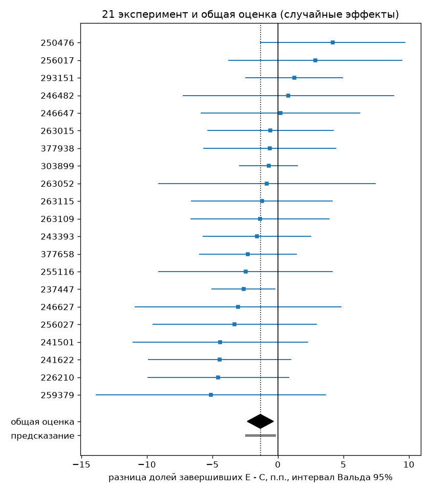

# A/B-тесты в ASSISTments

ASSISTments - онлайн-платформа, на которой школьники решают задачи по математике. В ней прошли 22 рандомизированных
эксперимента, в каждом контрольная группа и одно экспериментальное условие. Я разбираю их как продуктовый аналитик:
проверяю данные и сравнимость групп, оцениваю каждый тест с учётом мощности и множественных сравнений и решаю,
выкатывать изменение, не выкатывать или данных мало.

Результат: выкатывать нечего. Ни один из 21 эксперимента не улучшил долю завершивших задание значимо. По правилу,
зафиксированному до расчёта эффектов, 7 экспериментов - «не выкатывать», 14 - «мало данных», а 263057 исключён
из-за несравнимых групп. Тесты слишком малы: при медианных 260 учениках в группе MDE 7,6 п.п., а мета-анализ всех
21 эффекта даёт -1,3 п.п. (интервал от -2,3 до -0,3), так что реалистичный масштаб эффекта здесь - 1-2 п.п.



| problem_set | n | эффект, п.п. | интервал 95%, п.п. | p_BH | решение |
|---|---|---|---|---|---|
| 226210 | 1 185 | -4,5 | -9,9 ... +0,9 | 0,72 | не выкатывать |
| 237447 | 692 | -2,6 | -5,1 ... -0,2 | 0,72 | не выкатывать |
| 241501 | 381 | -4,4 | -11,2 ... +2,4 | 0,77 | не выкатывать |
| 241622 | 627 | -4,4 | -9,9 ... +0,9 | 0,72 | не выкатывать |
| 243393 | 1 797 | -1,6 | -5,7 ... +2,6 | 0,82 | не выкатывать |
| 246482 | 457 | +0,8 | -7,1 ... +9,0 | 0,89 | мало данных |
| 246627 | 514 | -3,0 | -10,8 ... +5,1 | 0,82 | мало данных |
| 246647 | 538 | +0,2 | -5,8 ... +6,5 | 0,95 | мало данных |
| 250476 | 402 | +4,2 | -1,4 ... +9,7 | 0,72 | мало данных |
| 255116 | 534 | -2,5 | -9,2 ... +4,3 | 0,82 | мало данных |
| 256017 | 412 | +2,9 | -3,9 ... +9,5 | 0,82 | мало данных |
| 256027 | 335 | -3,3 | -9,8 ... +2,8 | 0,80 | мало данных |
| 259379 | 497 | -5,1 | -14,0 ... +3,8 | 0,77 | мало данных |
| 263015 | 704 | -0,6 | -5,4 ... +4,2 | 0,89 | мало данных |
| 263052 | 523 | -0,8 | -9,2 ... +7,3 | 0,89 | мало данных |
| 263057 | 136 | -4,7 | -15,1 ... +5,6 | - | исключён |
| 263109 | 428 | -1,3 | -6,6 ... +3,9 | 0,86 | мало данных |
| 263115 | 754 | -1,2 | -6,7 ... +4,1 | 0,87 | мало данных |
| 293151 | 1 259 | +1,3 | -2,4 ... +5,0 | 0,82 | мало данных |
| 303899 | 1 917 | -0,7 | -2,9 ... +1,6 | 0,82 | не выкатывать |
| 377658 | 429 | -2,3 | -6,0 ... +1,4 | 0,77 | не выкатывать |
| 377938 | 426 | -0,6 | -5,8 ... +4,1 | 0,89 | мало данных |

Эффект - разница долей завершивших E - C, интервал - бутстреп, p_BH - p-value z-теста после поправки BH по 21 тесту.
В 256027 по самому файлу было бы «не выкатывать», но решение меняется, если в контроле не хватает 6 рано бросивших.
293151 - гипотеза для повторного теста: среди учеников, у которых сработало условие, +8,4 п.п.

## Как устроено решение

1. Проверка данных. Все агрегаты и проверки написаны на SQL и выполняются в DuckDB. В файле 14 947 строк (ученик
   в эксперименте), 22 эксперимента и 8 205 учеников, 2 751 из них (33,5%) участвовали больше чем в одном.
   Со статьёй о датасете файл расходится: учеников 8 205 против 8 297, строк 14 947 против 15 112 по Table 1.
   Файлы на сайте обновлены 29.09.2016, после статьи, поэтому предполагаю другую версию данных. Дублей нет,
   производные колонки сходятся с формулами, CSV и xlsx совпадают. `Birthyear` и `Class Grade` грязные
   (364 неправдоподобных года рождения, 3 806 пустых классов), в анализе они не нужны. 701 ученик завершил задание
   за 2 задачи, все в экспериментах с проверкой видео: похоже, ответ на вопрос-проверку засчитывается в серию
   (предположение). Из-за этого и из-за разных правил завершения число задач сравниваю только между группами внутри
   одного эксперимента.
2. Сравнимость групп. Основная выборка - все ученики в файле: группа известна и тем, кто своё условие не увидел.
   SRM (ожидаемое деление 50/50 - допущение) и баланс ковариат проблем не нашли. Порог |SMD| > 0,1 на группах
   в сотни учеников срабатывает от шума, поэтому баланс проверял перестановками меток групп по максимальному |SMD|:
   ни в одной из 37 выборок p не ниже 0,05. В 7 экспериментах условие увидели все, в 14 доли увидевших в C и E
   совпадают, там делаю триггерный анализ как вторичный.
3. Эксперимент 263057. Все 7 не увидевших условие - в группе E и бросили ровно на 7-й задаче, а в контроле нет
   ни одного бросившего раньше 10-й. Похоже, такие ученики контроля в файл не попали (предположение). Оставить
   в обеих группах только дошедших до 10-й задачи нельзя: в E условие срабатывает уже к 7-й, и фильтр отбирает
   по следствию воздействия. Эксперимент исключил из решений. Та же проверка без флага нашла похожий, но слабый
   случай в 256027: 6 рано бросивших в E без пары в C (p = 0,031 при пороге, выбранном по данным). Его оставил
   и проверяю устойчивость, добавляя в C 6 бросивших. Доли не видящих видео различаются в 259379 (p = 0,035),
   но это одно срабатывание из 8 тестов, после BH 0,21: повод для проверки устойчивости, а не доказательство проблемы.
4. План до расчёта эффектов. Выборки, тест и правило решений я записал и закоммитил до того, как посчитал первый
   эффект, и потом не менял. Единственная правка - ошибка подсчёта в тексте (13 экспериментов с симметричным
   триггером вместо 14), критерий и расчёты остались те же. Метрика - доля завершивших, двусторонний z-тест,
   перцентильный бутстреп 95% (10 000 повторов, сид 42). Выкатывать - если эффект значим после BH и больше нуля;
   не выкатывать - если значим и меньше нуля или незначим и верхняя граница интервала ниже +3 п.п.; иначе мало
   данных. +3 п.п. - продуктовое допущение: данных о стоимости изменений нет, а при доле завершивших около 85% это
   примерно каждый пятый бросивший, который теперь доходит до конца. Меньший прирост вряд ли окупает работу над
   контентом. Порог влияет только на выбор между «не выкатывать» и «мало данных».
5. Эффекты. Без поправки p < 0,05 только в 237447: -2,6 п.п. В 16 из 21 эксперимента оценка ниже нуля, медианная
   ширина интервала 10,8 п.п. Бутстреп и интервал Вальда расходятся не больше чем на 0,32 п.п. Проверки устойчивости
   почти везде сохраняют знак эффекта: 13 из 14 в триггерном анализе, 9 из 9 без не видящих видео. Вторичная
   метрика - число задач до завершения среди завершивших. В 5 экспериментах у завершивших в E на 10-29% больше
   задач, но это описание, а не эффект: условие может менять, кто завершает.
6. Мощность. MDE при α = 0,05 и мощности 0,8 - от 2,6 до 12,5 п.п., медиана 7,6, больше 3 п.п. в 20 экспериментах
   из 21. Исключение, 237447, - с контролем 98,5%, где расти некуда. Для +3 п.п. нужно от 809 до 4 315 учеников
   в группе, в медиане в 6,2 раза больше, чем было.
7. Множественные сравнения. В правило решений входит только подтверждающее семейство: 21 тест основной выборки.
   Без поправки там p < 0,05 один раз, при 21 тесте без эффектов случайно ожидается 1,05; после BH и Bonferroni - 0.
   Треть учеников была в нескольких экспериментах, так что тесты зависимы. BH верен при положительной зависимости,
   а её не доказать, поэтому справочно добавил поправку BY, верную при любой: тоже 0. Триггерный анализ (14 тестов),
   выборка без не видящих видео (9) и вторичная метрика (21) - исследовательские семейства: p без поправки и с BH
   внутри семейства, в решения они не входят. После BH там значимы только два теста вторичной метрики.
8. 293151. Среди увидевших условие +8,4 п.п. (p = 0,040), на всех +1,3 п.п. Это согласуется как один эффект,
   размытый на всех: 0,33 x 8,4 = 2,7 п.п. лежит внутри интервала для всех, а среди не увидевших условие эффект
   совместим с нулём. Но после BH внутри 14 триггерных тестов p = 0,49. Чтобы подтвердить +8,4 п.п., нужно 378
   увидевших условие в группе, около 2 300 учеников всего; в тесте их было 410 на обе группы.
9. Решения и витрина. Правило применено без изменений, итог в таблице выше. Та же таблица собирается на SQL в витрину
   `experiment_summary`: размеры групп, доли, эффект, интервал, p до и после BH, MDE и решение. «Не выкатывать»
   опирается на интервалы без поправки на 21 тест, в 241501 и 243393 верхняя граница близка к порогу.
10. Мета-анализ, исследовательский. Случайные эффекты по DerSimonian-Laird на 21 эксперименте: -1,3 п.п., интервал
    от -2,3 до -0,3, неоднородности не видно (I² = 0). Бутстреп по ученикам, где каждый ученик приносит все свои
    эксперименты, даёт интервал от -2,4 до -0,2, почти тот же. Условия разные, поэтому это средний эффект «какого-то
    изменения задания», а не решение по конкретному тесту. Для будущих тестов здесь стоит закладывать MDE около
    1-2 п.п.: для 2 п.п. нужно около 4 400 учеников в группе.

## Как запустить

Нужен Python 3.13. При первом запуске DuckDB скачивает расширение excel для чтения xlsx, нужен интернет.

```bash
python3 -m venv .venv && .venv/bin/pip install -r requirements.txt
```

Положите `ThisOne.csv` и `ThisOne.xlsx` в `data/` (или укажите папку в переменной `ASSISTMENTS_DATA_DIR`).
Ноутбуки выполняются по порядку, каждый за 5-15 секунд:

```bash
for nb in notebooks/0*.ipynb; do .venv/bin/jupyter nbconvert --to notebook --execute --inplace "$nb"; done
```

Витрина `experiment_summary` сохраняется в `data/experiment_summary.csv` за пару секунд:

```bash
.venv/bin/python -m src.mart
```

Тесты статистических функций, пара секунд:

```bash
.venv/bin/python -m pytest tests
```

## Структура

- `sql/staging.sql` - вьюха над CSV: имена в snake_case, без лишних кавычек, `N/A` -> NULL, `Uknown` -> `Unknown`.
- `sql/columns.sql` - тип и доля пропусков по колонкам.
- `sql/quality.sql` - сверка со статьёй и с xlsx, дубли, некорректные значения, условие, видео, правило завершения.
- `sql/groups.sql` - размеры групп, увидевшие условие, ковариаты, ранние бросившие, завершившие по выборкам.
- `sql/mart.sql` - витрина `experiment_summary`: BH, MDE и правило решений на SQL.
- `src/config.py` - пути, сид и уровень значимости.
- `src/db.py` - подключение к DuckDB и запуск именованных запросов из `sql/`.
- `src/stats.py` - SRM, z-тест, интервалы и бутстреп, SMD и проверка баланса, MDE, поправки, мета-анализ.
- `src/effects.py` - эффект на долю завершивших по выборкам.
- `src/mart.py` - сборка витрины.
- `tests/test_stats.py` - тесты статистических функций на примерах с известным ответом.
- `notebooks/01_data_quality.ipynb` - таблица колонок и отчёт о качестве данных.
- `notebooks/02_comparability.ipynb` - SRM, триггер, ранние бросившие, баланс ковариат, план анализа.
- `notebooks/03_effects.ipynb` - эффект в каждом эксперименте, проверки устойчивости, вторичная метрика.
- `notebooks/04_power.ipynb` - MDE и размер выборки для +3 п.п.
- `notebooks/05_multiple_testing.ipynb` - поправки по семействам тестов, разбор 293151.
- `notebooks/06_decisions.ipynb` - таблица решений и проверка витрины.
- `notebooks/07_meta_analysis.ipynb` - мета-анализ эффектов и бутстреп по ученикам.
- `images/meta_forest.png` - картинка для README, её сохраняет ноутбук 07.

Колонки, которые нужны для анализа (полная таблица в ноутбуке 01):

| В файле | В staging | Что это |
|---|---|---|
| problem_set | experiment_id | эксперимент |
| InferredCondition | grp | группа C или E, восстановлена по задачам |
| ExperiencedCondition | experienced | увидел ли ученик условие (предположение по названию) |
| Could See Video | could_see_video | итог проверки видео, только в 9 экспериментах |
| complete | complete | завершил ли задание, основная метрика |
| ProblemCount, log(count) | problem_count, log_count | задач до завершения и их log10, вторичная метрика |
| Prior Percent Correct и ещё 4 | prior_pct_correct, ... | ковариаты для проверки баланса групп |

## Данные и библиотеки

Датасет: Selent, D., Patikorn, T., Heffernan, N. (2016). ASSISTments Dataset from Multiple Randomized Controlled
Experiments. Proceedings of the Third ACM Conference on Learning @ Scale (L@S 2016). Файлы на сайте авторов:
https://sites.google.com/site/las2016data/home. Данные и статьи в репозиторий не входят.

- [DuckDB](https://duckdb.org) - MIT
- [pandas](https://pandas.pydata.org), [NumPy](https://numpy.org), [SciPy](https://scipy.org) - BSD-3-Clause
- [Matplotlib](https://matplotlib.org) - Matplotlib License (на основе PSF)
- [Jupyter](https://jupyter.org) - BSD-3-Clause
- [pytest](https://pytest.org) - MIT
